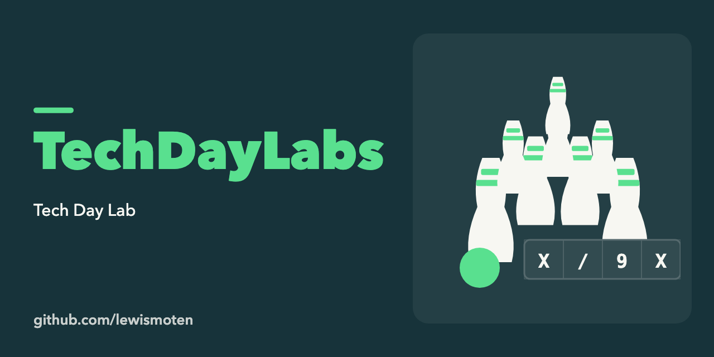

# TechDayLabs

Code from a 2013 tech day lab. It holds one exercise, a bowling-score solution built test-first (TDD kata) in C# with NUnit and Rhino Mocks, in [TDDKata_Bowling/](TDDKata_Bowling/).

## Status

Old exercise, not maintained. Open the solution in `TDDKata_Bowling/LMBS/BowlingSolution` with Visual Studio.
